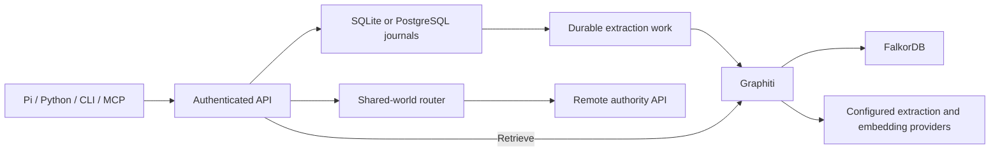

# How Memory Worlds stores and shares memory

[Documentation](README.md)

An authority is one service identity with its own users, grants, journals and
graph namespaces. A user's local authority can serve multiple agents and remote
machines. A corporate authority serves many users, each with private work memory
and access to selected shared worlds.

## Worlds organize memory; scopes bound its audience

World kinds are personal, private-work, team, company and ad-hoc. A world contains
scopes for world-shared knowledge, run-shared context, persistent agent memory,
resumable thread-private context and
invocation-private scratch. A private subagent scope can live inside a team world
without exposing its contents to the team.

Each memory has a world ID and scope UUID. Display names and aliases make selection
easier; live credentials and grants authorize it. Delegation can narrow a child
credential's access and lifetime. Parent and sibling agents receive no implicit
access to a child's private memory. See [scopes and delegation](scopes.md).

Clients select read scopes independently of their write destination. Native Pi
tracks context exposure across branches and reloads and stops automatic capture
when the destination cannot safely receive that context. A storage permission
check cannot prevent an arbitrary client from copying model-visible private text
into a later publication.

## Durable evidence and derived knowledge

Capture receipts establish durable source storage. Extraction is queued by
default and has separate processing state. Graphiti extracts entities and facts
and retrieves them within isolated scope namespaces. Retrieval retains source
provenance so a client can inspect the authorized evidence.

Private thread archives preserve selected typed events as compressed source
records. Explicit maintenance jobs derive same-scope summaries or enrichment
assessments through an independently configured lightweight model. Summaries
remain tentative and retain digest-qualified dependencies on their sources;
retracting an input immediately hides its derivatives. See
[thread context and maintenance workers](maintenance.md).

Source-only capture and source search are explicit choices. A graph error is
reported as a graph error. A failed or interrupted graph write can degrade a
namespace until an isolated generation rebuild succeeds. See
[Graphiti operations](graphiti.md) and [storage](storage.md).

SQLite has one owning daemon per data directory. PostgreSQL supports multiple
API replicas with durable work claims, leases, fencing and authority maintenance.
FalkorDB is a separate graph backend in both configurations. RDS hosts the
relational journals; it does not replace FalkorDB. See
[PostgreSQL and RDS](rds-postgresql.md).

## Shared access and publication

OIDC identifies users by verified issuer and subject. A user gets a stable
private-work identity; team/company access comes from explicit membership or
configured [organization groups and role profiles](corporate-access.md). Local agent tokens retain their explicit grants
rather than inheriting all of their user's memberships.

Router mounts allow selected remote shared worlds. They pin the remote authority,
use operator-configured credentials, and grant local readers or publishers
explicit access. Private remote worlds are accessed directly. Publication queues
selected text in a durable outbox; a queued receipt and a successful remote
delivery are separate states.

Chat sharing can automate excerpt selection only within an explicitly enabled
per-chat rule. The configured destination, exclusions and authorization remain
outside the classifier's control. See [routing](sharing.md),
[organization policy](corporate-access.md), [OIDC](oidc-okta.md) and
[chat sharing](chat-sharing.md).

## Recovery preserves different things

Portable `.mworld` archives preserve source evidence and attribution for transfer
between worlds. Graph re-extraction can produce different derived results.
Encrypted authority backups preserve identities, grants, journals, work state
and native FalkorDB snapshots, or explicitly request graph rebuilding.

Sync completed backup artifacts through OneDrive or object storage. Keep active
SQLite, WAL and graph files outside file-sync folders. See
[portable archives](portable-archives.md), [authority recovery](recovery.md) and
[lifecycle operations](lifecycle.md).
