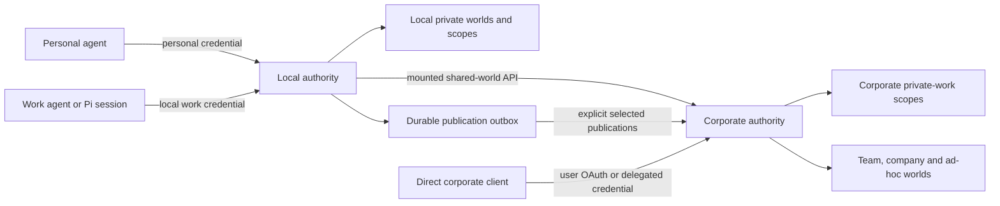

# Run local and corporate memory together

The [guided setup](setup.md) can generate the local authority, credentials,
selected corporate mounts and separate client profiles. This guide explains the
same boundaries and the manual configuration steps.

Run two independent authorities: a user-owned local daemon and an
organization-operated corporate service. Agents use the local API for local
memory and configured mounts for selected corporate shared worlds. A separate
direct corporate connection reaches the user's corporate private-work memory.



The router accepts only corporate shared worlds' world-shared scopes. Corporate
personal/private-work worlds and their private scopes require the direct
connection. A mount is a route, not a local replica or a bidirectional database
sync. Each authority retains its own identity, grants, journals and graph backend.

## Choose where information belongs

| Information | Suggested placement | Access path |
| --- | --- | --- |
| Personal preferences and private personal notes | Local personal world/private scopes | Local API or SSH tunnel |
| Work notes permitted to reside on the user's machine | Separate local private-work world/private scopes | Local work credential |
| Work notes that should remain on company infrastructure | Corporate private-work world/private scopes | Direct corporate API |
| Published procedures, decisions and team knowledge | Appropriate corporate shared world | Shared mount or direct corporate API |
| Subagent working notes | Its explicitly delegated invocation-private scope | That subagent's credential |

Separate local personal and work credentials as well as their worlds. A scope or
world name does not grant access. Corporate private-work means private from other
ordinary users under the service's grants; authority operators control its
storage. Local storage also does not imply local model processing: configure
extraction, embedding and Pi model providers appropriate to the data being used.

## Prepare the corporate service

The corporate operator deploys the [Helm chart](helm.md), selects PostgreSQL
shared journals and an authenticated FalkorDB graph backend, and configures TLS,
[OIDC/Okta](oidc-okta.md), shared worlds and group mappings. Amazon RDS can supply
the [PostgreSQL journals](rds-postgresql.md); no graph extension or Neptune service
is required. Multiple API replicas share one corporate authority UUID and its
backends. Scaling the API does not replicate the bundled FalkorDB pod.

Keep corporate database credentials, model credentials and operator tokens in
the corporate deployment. A user's machine needs the API URL, the public OAuth
client configuration and its own API access token. Neither user discovery nor
mounting readable corporate worlds requires a corporate administrator token.

Sign in and discover with the normal user token. Run from the repository using
the locked mise tasks; installed clients can invoke `memory-worlds` directly.

```sh
umask 077
mkdir -p "$HOME/.config/memory-worlds/hybrid"
mise run cli -- --url https://memory.example.org login \
  --issuer https://YOUR_OKTA_DOMAIN/oauth2/YOUR_AUTHORIZATION_SERVER_ID \
  --client-id YOUR_NATIVE_APPLICATION_CLIENT_ID \
  --scope openid --scope memory-worlds \
  --token-output "$HOME/.config/memory-worlds/hybrid/corporate.token"
mise run cli -- --url https://memory.example.org \
  --token-file "$HOME/.config/memory-worlds/hybrid/corporate.token" me
mise run cli -- --url https://memory.example.org \
  --token-file "$HOME/.config/memory-worlds/hybrid/corporate.token" \
  discover --scopes --json
```

Record `authority_id` from `me`, the canonical shared world IDs, and the user's
private-work world ID if needed. Select only the shared worlds intended for the
local mount. The service URL is configured explicitly; discovery does not scan
the network. Login writes a new private file and refuses to overwrite one.

Corporate issuer/subject identity and a local owner such as `alice` are separate
identities. Their user IDs, credential IDs and world IDs need not match. The
corporate token authenticates the corporate user; local mount grants identify
the local user or local credential.

## Prepare the local service and work credential

Complete the [local quickstart](../README.md#run-locally) first: initialize one
local authority, configure its explicit Graphiti model providers, start its
authenticated loopback FalkorDB backend and run one owning daemon. Keep SQLite
and the active graph on local storage. The examples below use that quickstart's
local owner `alice` and local operator file; substitute your actual owner.

Keep the personal agent credential limited to its personal world. Create a
separate local private-work world for work-related notes and issue a credential
limited to that world:

```sh
mise run cli -- --url http://127.0.0.1:8787 \
  --token-file "$HOME/.config/memory-worlds/admin.token" \
  world-create 'Local work notes' --kind private-work --owner alice --alias workbench
```

Replace `LOCAL_WORK_WORLD_ID` with the returned ID:

```sh
umask 077
mise run cli -- --url http://127.0.0.1:8787 \
  --token-file "$HOME/.config/memory-worlds/admin.token" \
  token-create --user alice --agent work-pi --grant LOCAL_WORK_WORLD_ID:writer \
  > "$HOME/.config/memory-worlds/hybrid/local-work-agent.json"
mise exec -- python - <<'PY'
import json
from pathlib import Path
folder = Path.home() / ".config/memory-worlds/hybrid"
receipt = json.loads((folder / "local-work-agent.json").read_text())
with (folder / "local-work.token").open("x") as output:
    output.write(receipt["token"] + "\n")
print("Local work credential ID:", receipt["credential_id"])
PY
cat > "$HOME/.config/memory-worlds/hybrid/notes-scope.json" <<'JSON'
{"kind":"agent-persistent","name":"Local work notes","alias":"notes"}
JSON
mise run cli -- --url http://127.0.0.1:8787 \
  --token-file "$HOME/.config/memory-worlds/hybrid/local-work.token" \
  scope-create @workbench --input "$HOME/.config/memory-worlds/hybrid/notes-scope.json"
```

The credential receipt contains a secret and stays outside the checkout. Keep
the operator credential out of Pi, MCP and routine agents. The work credential
can read/write its authorized local world; the profile below selects reads and
omits a default write target. For enforced read-only clients, issue a reader
credential with only the necessary scope-read grants.

## Mount selected corporate shared worlds locally

Create `$HOME/.config/memory-worlds/hybrid/mounts.json` with these contents,
replacing all uppercase ID placeholders with values obtained above:

```json
{
  "version": 1,
  "mounts": [
    {
      "id": "corporate",
      "name": "Corporate shared knowledge",
      "url": "https://memory.example.org",
      "authority_id": "CORPORATE_AUTHORITY_ID",
      "world_ids": ["COMPANY_WORLD_ID", "TEAM_WORLD_ID"],
      "token_file": "corporate.token",
      "user_grants": {},
      "credential_grants": {"LOCAL_WORK_CREDENTIAL_ID": "reader"},
      "publish": false
    }
  ]
}
```

The credential grant restricts this route to the local work credential; another
credential for the same local user does not inherit it. An explicit `user_grants`
entry instead enables the route for that local user's ordinary credentials.
Local administrators control configuration and can access configured mounts.
The configured remote credential independently limits what the corporate API
will return. Use one user's remote token per user-specific mount rather than a
shared corporate administrator/service credential.

The relative token path resolves beside `mounts.json`. Keep the directory private
and token files mode `0600`. Stop the local daemon, then restart it against the
same local data directory with the mount configuration:

```sh
MEMORY_WORLDS_MOUNTS_FILE="$HOME/.config/memory-worlds/hybrid/mounts.json" \
  mise run cli -- serve
```

Do not initialize again or start a second owner of the local data directory.
Keep the local runtime's graph/model configuration; it does not need the
corporate SQL connection string. A changed mount configuration requires another
restart. Token replacement at the configured path is read on subsequent requests.

Verify the local route with the ordinary work credential:

```sh
mise run cli -- --url http://127.0.0.1:8787 \
  --token-file "$HOME/.config/memory-worlds/hybrid/local-work.token" \
  discover --scopes --json
mise run cli -- --url http://127.0.0.1:8787 \
  --token-file "$HOME/.config/memory-worlds/hybrid/local-work.token" \
  route-search 'Selected work query' --mount corporate
```

Local discovery returns local worlds/scopes and configured mount metadata. It
does not enumerate corporate worlds/private scopes; direct corporate discovery
does that. Routed results retain authority/world provenance and report partial
failures. Mount access is checked locally and again using the corporate token.

## Pi profiles and mixed sessions

Install the [native Pi extension](../packages/pi/README.md#install). Save the
following as `$HOME/.config/memory-worlds/hybrid/research-pi.json`:

```json
{
  "url": "http://127.0.0.1:8787",
  "tokenFile": "~/.config/memory-worlds/hybrid/local-work.token",
  "readScopes": [{"world_id":"@workbench","scope_id":"@notes"}],
  "readMountIds": ["corporate"],
  "automaticCapture": false,
  "retrieval": {"enabled":false,"mode":"graph","limit":5,"maxChars":8000}
}
```

Start a new independent chat with that profile. The `env -u` options prevent
global URL/token overrides from redirecting the selected profile:

```sh
env -u MEMORY_WORLDS_URL -u MEMORY_WORLDS_TOKEN_FILE \
  MEMORY_WORLDS_CONFIG="$HOME/.config/memory-worlds/hybrid/research-pi.json" pi
```

Use explicit discovery and searches:

```text
/memory discover
/memory mounts
/memory search Selected work query
/memory status
```

Pi has one primary URL/token, so `readScopes` refer to the local authority and
`readMountIds` name that daemon's configured corporate routes. The profile omits
a default capture target and disables automatic retrieval/capture. An explicit
search sends its query to selected mounts. If `retrieval.enabled` is enabled,
Pi sends the first 2,000 characters of each future prompt as the query, including
to selected mounts. Private sharing mode does not disable outbound retrieval.

Foreign evidence retrieved through the native extension stops automatic local
capture and automated chat sharing. Removing a mount, changing a branch,
compacting or forking a chat does not erase accumulated exposure. Use a fresh
independent local-only chat for
automatic local capture. Its separate profile should use `readMountIds: []`,
select only appropriate local scopes and set an explicit private `writeScope`;
then enable future capture deliberately. Personal chats should use the separate
personal credential and personal profile, rather than this work profile.

## Direct corporate private-work access

Use the corporate URL and corporate user token directly for private-work scopes:

```sh
mise run cli -- --url https://memory.example.org \
  --token-file "$HOME/.config/memory-worlds/hybrid/corporate.token" \
  discover --scopes --json
```

A fresh corporate login supplies the private-work world's world-shared scope;
Pi capture targets require an agent-persistent or invocation-private scope.
Select an existing authorized private scope, or create one using the same
private scope input prepared above. Replace `CORPORATE_PRIVATE_WORK_WORLD_ID`
with the ID from corporate discovery:

```sh
mise run cli -- --url https://memory.example.org \
  --token-file "$HOME/.config/memory-worlds/hybrid/corporate.token" \
  scope-create CORPORATE_PRIVATE_WORK_WORLD_ID \
  --input "$HOME/.config/memory-worlds/hybrid/notes-scope.json"
```

Keep the returned scope UUID; its `@notes` alias resolves only in that corporate
world. A separate Pi profile can start with:

```json
{
  "url": "https://memory.example.org",
  "tokenFile": "~/.config/memory-worlds/hybrid/corporate.token",
  "readScopes": [],
  "readMountIds": [],
  "automaticCapture": false,
  "retrieval": {"enabled":false,"mode":"graph","limit":5,"maxChars":8000}
}
```

Save it as `corporate-pi.json` beside the research profile and launch it in a
new independent chat using `MEMORY_WORLDS_CONFIG` as above. Discover, then select
the corporate private-work world and the returned private scope using
`/memory read WORLD SCOPE` and `/memory target WORLD SCOPE`. Additional private
scope access follows [scope grants](scopes.md), including after credential
rotation. This profile's state and all its selections belong to the corporate
authority. It does not simultaneously attach the laptop's private scopes.

Other harnesses can configure two named [MCP clients](agents.md), each using an
explicit URL and its corresponding `--token-file`. Both clients entering the
same model context can expose both sets of evidence to that model. Give a
work-only agent only the clients/credentials required for its task.
Independent MCP tools or other extensions are outside the native extension's
exposure tracking; do not treat that tracking as a guard over every tool in Pi.

Restricted delegated local subagents cannot use mounts, even if a mount grant
names their credential or their parent user can use the corporate mount.
Corporate work for a subagent needs a separately authorized corporate
client/credential. Ordinary local delegation
does not exchange or propagate a corporate token.

## Publish selected work knowledge

Start with reader mounts. To authorize publication, change the work credential's
mount role to `publisher`, set `publish: true`, and restart the local daemon.
The corporate credential must independently have writer/manager authorization
for the selected shared world. Mount `can_publish` describes the local gate;
it does not certify current corporate authorization.

```sh
mise run cli -- --url http://127.0.0.1:8787 \
  --token-file "$HOME/.config/memory-worlds/hybrid/local-work.token" \
  route-publish corporate TEAM_WORLD_ID --source-id reviewed-note-42 \
  --at 2026-10-21T12:00:00Z --text 'Selected reviewed knowledge for the team.'
mise run cli -- --url http://127.0.0.1:8787 \
  --token-file "$HOME/.config/memory-worlds/hybrid/local-work.token" deliveries
```

Use canonical remote world IDs; remote `@aliases` are not publication targets.
Pi exposes `/memory publish corporate TEAM_WORLD_ID Selected reviewed knowledge`.
Publication queues the text you explicitly provide. A successful enqueue
acknowledges the local outbox; `delivered`
confirms remote source acceptance. Graphiti extraction has its own later state.
Retain source ID, time and content unchanged for retries.

[Per-chat review/automatic sharing](chat-sharing.md) is separately user-enabled
and requires its configured classifier, destination and exclusions. It does not
make cross-authority mixed sessions eligible for automatic sharing. Use explicit
selected publication for those sessions.

## Rotation, outages, tunnels and recovery

- Device login keeps no refresh token. Before the corporate access token expires,
  log in to a new sibling path such as `corporate-next.token`, then rename it over
  `corporate.token` on the same filesystem. Login never overwrites the old file;
  no local daemon restart is needed for replacement at the same path. Corporate
  per-credential scope grants may need renewal for the new credential ID.
- Source-side corporate memberships and revocation are checked by the corporate
  service. External Okta group changes are observed through newly issued tokens;
  the local mount does not poll Okta or grant corporate membership.
- Corporate outages leave local sources available. Routed search reports its
  failure instead of a complete empty result. Local source receipts and remote
  publication delivery are separate. Expired-token/permission failures can block
  deliveries; after fixing access, the owner explicitly uses
  `delivery-retry DELIVERY_ID`. Replacing the token alone does not retry a blocked
  entry. See the [router contract](sharing.md).
- An SSH tunnel changes transport, not identity. The [SSH examples](../README.md#remote-agents-over-ssh)
  cover remote agents reaching the local daemon. A corporate loopback forward
  should use another port, such as `18787`, so it does not collide with local
  `8787`; pin the same corporate authority ID when routing through it. Agents
  connect to authenticated API endpoints, not raw graph/database ports.
- Keep independent [backups](recovery.md) for the local and corporate authorities.
  Export completed artifacts or encrypted backups to cloud storage; do not sync
  open SQLite files or active graph directories. Corporate data remains governed
  by its chosen destination and backup policy. Mounting it creates no local
  offline replica. Pi session files, tool results and publication outbox entries
  can nevertheless contain the work text handled on the user's machine.

The [knowledge-import design](superpowers/specs/2026-10-21-knowledge-import-design.md)
is separate from this deployed routing model. Snapshot imports do not establish
continuous source ACL synchronization or automatic document freshness.
